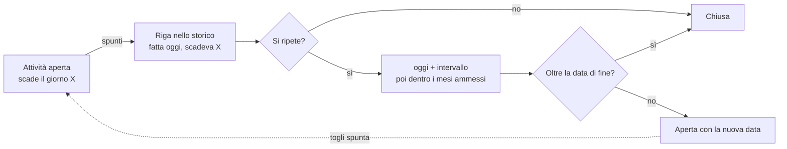

# Come funziona ortDirector

Cosa succede davvero quando aggiungi una pianta, spunti un'attività o premi "Ha piovuto". Per installare e lanciare l'app vedi il [README](../README.md).

## La forma dell'app

Tutto sta sul telefono. Niente server, niente account, niente rete. I dati vivono in un file SQLite, `ortdirector.db`, dentro l'app. Se cancelli l'app senza backup, perdi tutto.

Il codice è diviso in due strati:

- **Le schermate** (`src/app/`): Oggi, Piante, Impostazioni, il dettaglio pianta, i form. Mostrano dati e chiamano funzioni. Decidono poco.
- **La logica** (`src/lib/`), di due tipi:
  - *Logica pura*: calcoli su date e numeri, senza database né telefono. `schedule.ts` (date, ripetizioni, pioggia, promemoria), `watering.ts` (intervalli), `plans.ts` (piani di cura), `presets.ts` e `kinds.ts` (catalogo), `backup.ts`, `catalogFile.ts`.
  - *Database*: `db.ts`. Prende le decisioni della logica pura e le scrive nelle tabelle: crea attività, le sposta, le chiude, migra lo schema, importa i backup.

Quando l'app parte, `src/app/_layout.tsx` apre il database e chiama `migrate()`, che porta lo schema all'ultima versione e carica in memoria le piante aggiunte al catalogo da file. Poi le schermate rileggono dal database ogni volta che tornano in primo piano.

## I dati

Sei tabelle. Le date sono testo `AAAA-MM-GG` in ora locale, così "oggi" è sempre il tuo oggi.

| Tabella | Cosa contiene |
| --- | --- |
| `plants` | Una riga per pianta: nome, voce di catalogo (`preset`), zona, in vaso sì/no, taglia pianta e vaso, al coperto, sole che le serve, intervallo d'acqua estivo e invernale, fase (semenzaio o a dimora), date di semina e trapianto, annuale, archiviata, foto, note. |
| `tasks` | Le attività aperte e chiuse. Ogni attività ha una scadenza (`due_on`) e, se si ripete, un intervallo, un intervallo invernale, una data di fine, i mesi ammessi, o "una volta l'anno". |
| `task_log` | Lo storico: cosa hai fatto e quando. Salva anche la scadenza di prima, per poter togliere la spunta. |
| `zones` | Aiuole, vasi, serra: nome, sole che prende davvero, coperta sì/no. |
| `catalog` | Le piante aggiunte al catalogo da file JSON, salvate così come erano nel file. |
| `settings` | Chiave/valore: ora del promemoria, ultima pioggia, ultimo backup. |

### Le versioni del database

Ogni funzione che ha richiesto una colonna nuova ha alzato di uno la versione del database (`PRAGMA user_version`). All'avvio `migrate()` legge la versione salvata e applica in ordine i passi mancanti: un telefono fermo alla v2 passa per v3, v4, v5, v6 e v7 in un colpo solo.

| Ver. | Cosa ha aggiunto | Cosa fa ai dati esistenti |
| --- | --- | --- |
| 1 | Piante, attività, storico, impostazioni | Crea le tabelle |
| 2 | Fase semenzaio, data di semina, voce di catalogo, fine di un'attività | Le piante esistenti sono considerate già a dimora |
| 3 | Attività annuali e mesi ammessi | Crea la cura stagionale per le piante già presenti |
| 4 | Zone, vaso, intervallo invernale | Ogni posizione scritta a mano diventa una zona. "serra", "tettoia", "casa" diventano zone coperte; "vaso", "balcone" segnano la pianta in vaso. Intervallo invernale = estivo × 3, al massimo 21 giorni |
| 5 | Annuali, archivio, foto, scadenza precedente nello storico | Segna come annuali gli ortaggi del catalogo |
| 6 | Catalogo da file, taglia pianta e vaso | Niente: taglie sconosciute contano come medie |
| 7 | Pianta "al coperto" singola | Niente |

Una nuova versione va aggiunta in fondo a `migrate()` e, con il suo schema, in `migrations.test.ts`. Le versioni già uscite non si toccano più.

## Attività e ripetizioni

Un'attività è una riga in `tasks` con una data. Oggi mostra tutte quelle aperte con data di oggi o passata. Quando la spunti (`markDone`) succedono due cose, in un'unica transazione:

1. Una riga va nello storico, con il giorno in cui l'hai fatta e la scadenza che aveva.
2. `completeTask` calcola la prossima data e l'attività si sposta lì. Se non c'è una prossima data, si chiude.

Le regole della prossima data:

- **Si conta da quando l'hai fatta, non da quando scadeva.** Annaffiare ogni 3 giorni, in ritardo di 2: torna 3 giorni dopo oggi.
- **Fuori stagione salta al primo giorno del primo mese ammesso.** "Concimare ogni 21 giorni, maggio-ottobre" spuntata il 20 ottobre torna il 1° maggio.
- **Annuale con mesi**: torna all'inizio della finestra dell'anno dopo (potatura a febbraio). **Annuale senza mesi**: stessa data fra 12 mesi.
- **Con data di fine**: se la prossima data cade dopo, l'attività si chiude. Così finisce l'annaffiatura di attecchimento.
- **Senza ripetizione**: si chiude.

Togliere la spunta (`undoDone`) cancella la riga di storico e rimette l'attività alla scadenza di prima. "Rimanda a domani", nella scheda dell'attività, cambia solo la data.

## Annaffiatura

Ogni pianta ha due intervalli: quello estivo (maggio-settembre) e quello per il resto dell'anno. L'attività "Annaffiare" della pianta li copia entrambi, e ogni volta che la spunti usa quello del mese in corso.

Da dove vengono i numeri, per una pianta del catalogo già a dimora (`watering.ts`):

1. Il catalogo dà l'intervallo per una pianta *media in piena terra*. Pomodoro: 2 giorni.
2. Lo moltiplichi per un fattore che dipende dalla taglia. Arrotondato, minimo 1 giorno, massimo 60.
3. L'intervallo invernale viene dal tipo di pianta se lo specifica, altrimenti è 3 volte quello estivo, al massimo 21 giorni.

| In piena terra | piccola | media | grande |
| --- | --- | --- | --- |
| fattore | ×0,5 | ×1 | ×1,5 |

| In vaso: pianta ↓ / vaso → | piccolo | medio | grande |
| --- | --- | --- | --- |
| pianta piccola | ×0,5 | ×0,7 | ×0,9 |
| pianta media | ×0,35 | ×0,5 | ×0,7 |
| pianta grande | ×0,25 | ×0,35 | ×0,5 |

Esempio: rosa (catalogo: ogni 3 giorni) grande in un vaso piccolo. 3 × 0,25 = 0,75, arrotondato a 1: ogni giorno d'estate, ogni 3 giorni il resto dell'anno.

Le piantine nel semenzaio usano il numero del catalogo senza scala. Se modifichi la pianta e cambi l'intervallo a mano, `updatePlant` aggiorna l'annaffiatura esistente invece di crearne una nuova.

## Pioggia

"Ha piovuto" non usa il meteo. Fa come se oggi avessi annaffiato tutte le piante che la pioggia raggiunge (`rained` in `db.ts`, `afterRain` in `schedule.ts`):

- Prende ogni annaffiatura aperta e ripetuta, **tranne** quelle di piante in una zona coperta o segnate "al coperto". I vasi all'aperto la pioggia la prendono.
- Nuova data = oggi + intervallo del mese. Se era già più lontana resta dov'era: la pioggia non anticipa mai niente.
- Salva in `settings` quali attività ha spostato e da che data, così "Annulla" le rimette dov'erano. Un'attività che hai spuntato o spostato nel frattempo non viene toccata.

Anche le annaffiature di attecchimento dopo un trapianto sono ripetute, quindi la pioggia sposta anche quelle.

## Stagioni

Ci sono due tipi di cura (`plans.ts`):

- **Cura dal trapianto** (`steps`): conta i giorni da quando la pianta è a dimora. Pomodoro: tutore al giorno 7, femminelle ogni 7 giorni dal 14 al 120, raccolta ogni 3 giorni dal 70 al 150. Molti passi hanno i mesi ammessi, così un trapianto tardivo non ti programma una raccolta a gennaio: se la stagione tornerebbe dopo la fine del passo, il passo non viene creato.
- **Cura stagionale** (`seasonal`): segue il calendario, per le perenni. Potare la rosa a febbraio, ritirare il limone a novembre. Viene creata quando aggiungi la pianta, alla prossima stagione utile, e torna ogni anno. Alcuni passi valgono solo per piante in vaso, in terra o che temono il gelo.

Archiviare un'annuale a fine stagione cancella le sue attività aperte e tiene lo storico. Ripristinarla ricrea annaffiatura e cura stagionale.

## Semina e trapianto

1. **Semini.** La pianta è "in semenzaio" con la data di semina. Se il catalogo sa dopo quante settimane si trapianta (pomodoro: 6-8), nasce l'attività "Pronta da trapiantare" al minimo, 6 settimane dopo. Se cambi la data di semina, l'attività si sposta.
2. **Segni il trapianto.** La schermata propone i passi del piano contati dal giorno del trapianto e chiede vaso e taglie. I passi che non vuoi si tolgono.
3. **Cosa scrive `transplant()`**: pianta a dimora con data e taglie, intervallo d'acqua ricalcolato con le tabelle sopra, "Pronta da trapiantare" chiusa, una riga nello storico, i passi scelti creati. Se il piano ha un'annaffiatura di attecchimento (pomodoro: ogni giorno per 2 settimane), quella normale viene spostata a dopo la sua fine, così non annaffi due volte.
4. **Trapianto con data passata.** I passi singoli già passati vengono saltati, quelli ripetuti partono dalla prossima data utile da oggi. Così segnare un trapianto vecchio non riempie Oggi di ritardi.

## Catalogo da file

Impostazioni › Catalogo apre un file JSON (formato in [catalog-file.md](catalog-file.md)). `catalogFile.ts` controlla ogni voce e dice cosa non va e dove. Una voce non può ridefinire una pianta già nel catalogo integrato. Le voci buone finiscono nella tabella `catalog` così come le hai scritte, e a ogni avvio vengono rilette in memoria accanto a quelle integrate. Togliere una voce non tocca le piante già create da quella voce.

## Backup

- **Esporta**: tutte le tabelle diventano un file JSON con la versione del database. Passa dal foglio di condivisione di iOS (File, iCloud, AirDrop).
- **Importa**: prima controlla che sia un backup di ortDirector e non di una versione più nuova dell'app. Poi, in una transazione unica, svuota tutto e reinserisce le righe del file, scartando colonne che non esistono. Se qualcosa va storto a metà, non cambia niente.
- I backup vecchi sono accettati: le colonne arrivate dopo prendono il valore di default.
- **Le foto non sono nel backup.** C'è solo il nome del file: su un telefono nuovo le piante avranno il riferimento ma non l'immagine.

## Notifiche

Una notifica al giorno, all'ora scelta in Impostazioni (8 di default), per i prossimi 30 giorni. Elenca fino a 3 attività e dice "e altre N". Quelle in ritardo finiscono nella notifica di oggi. Dopo ogni modifica l'app cancella le notifiche programmate e le ricrea da zero (`notifications.ts`). Una al giorno invece di una per attività perché iOS ne tiene al massimo 64 in coda.

## Test

`yarn test` fa girare tutto con `node --test`, in un secondo, e GitHub lo lancia a ogni pull request insieme a `yarn typecheck`.

| File | Cosa verifica |
| --- | --- |
| `schedule.test.ts` | Date, ripetizioni, stagioni, pioggia come calcolo, promemoria |
| `plans.test.ts` | Piani di cura, tabelle dell'acqua, tipi di pianta |
| `catalogFile.test.ts`, `backup.test.ts` | Lettura dei file di catalogo e di backup |
| `i18n.test.ts` | Traduzioni del catalogo e delle etichette |
| `db.test.ts` | Cosa scrive ogni azione su un SQLite vero in memoria: spunta, pioggia, trapianto, archivio, zone, catalogo, backup |
| `migrations.test.ts` | Un giardino a ogni versione vecchia del database, aggiornato all'ultima |

`db.test.ts` e `migrations.test.ts` usano `memoryDb.ts`: il SQLite di Node dietro i pochi metodi di expo-sqlite che `db.ts` usa. Le schermate e il codice che parla con iOS (notifiche, foto, file) non hanno test automatici.
